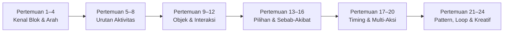
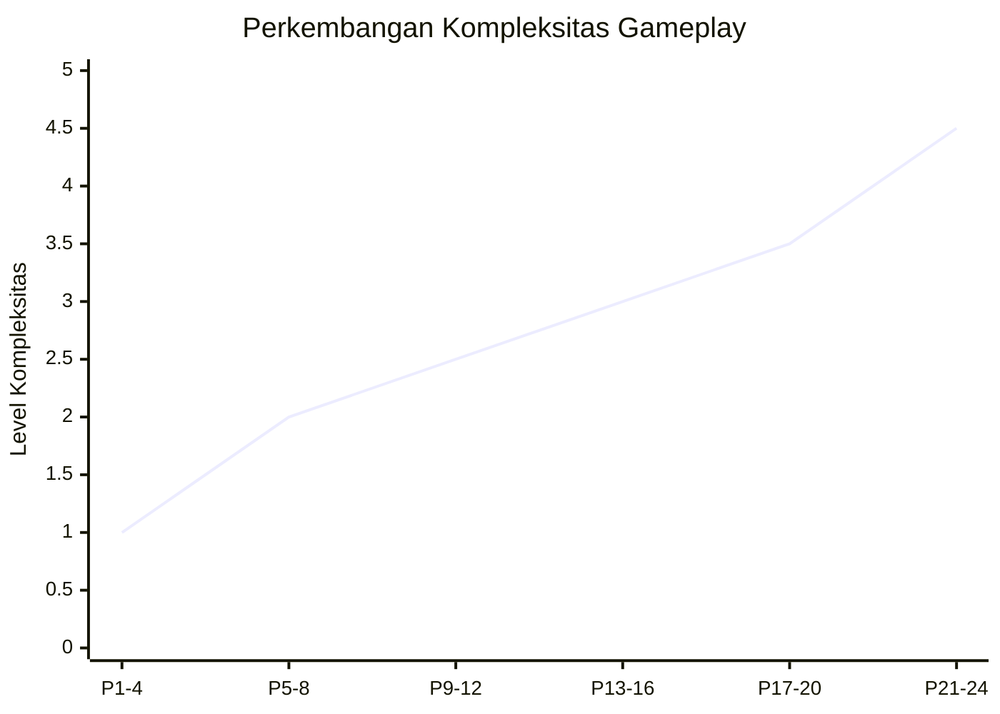
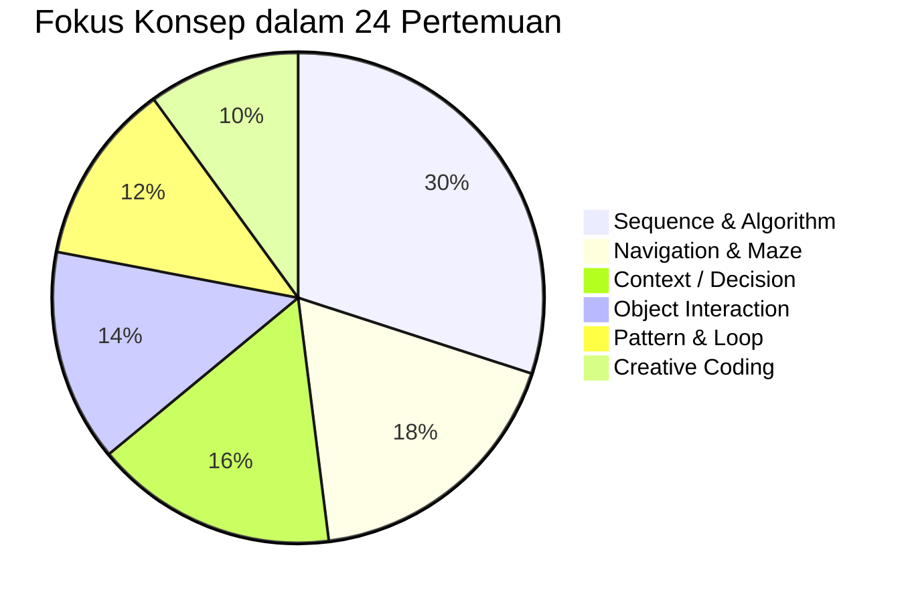
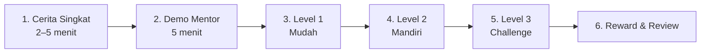

# Kurikulum IKOOS Junior Coding

## 24 Pertemuan — Versi Gameplay Detail

> **Tujuan utama:** Membantu anak TK mengenal logika dan pola pikir coding secara bertahap melalui permainan edukatif Islami, sehingga saat masuk SD mereka lebih mudah memahami konsep dan blok perintah di Scratch.

---

## 1. Konsep Dasar Kurikulum

IKOOS Junior Coding tidak dirancang sebagai kumpulan kuis biasa. Setiap pertemuan tetap menggunakan **blok perintah** sebagai fondasi utama, tetapi bentuk misi dan tujuan permainannya dibuat berbeda-beda agar anak tidak cepat bosan.

Prinsip utamanya:

- **Blok tetap konsisten**, sehingga anak familiar dengan pola seperti Scratch.
- **Gameplay berganti-ganti**, sehingga setiap pertemuan terasa seperti permainan baru.
- **Instruksi dibuat singkat dan visual**, karena target utama adalah anak TK.
- **Satu layar = satu tugas utama.**
- **Setiap pertemuan idealnya terdiri dari 3 mini-level:** mudah, sedang, dan tantangan.
- **Nilai Islami + computational thinking** berjalan bersama.

---


## 2. Blok Perintah Inti


| Kategori    | Contoh Blok                          | Fungsi                         |
| ----------- | ------------------------------------ | ------------------------------ |
| Event       | 🚩 Start                             | Memulai program                |
| Gerak       | ➡️ Kanan, ⬅️ Kiri, ⬆️ Maju, ⬇️ Turun | Menggerakkan karakter          |
| Aksi        | 🦘 Lompat                            | Melewati rintangan             |
| Waktu       | ⏳ Tunggu                             | Menunda aksi                   |
| Suara       | 🔊 Putar Suara                       | Memainkan audio                |
| Rekam       | 🎤 Rekam Suara                       | Menggunakan suara anak         |
| Dialog      | 💬 Bicara                            | Mengucapkan kalimat tertentu   |
| Pengulangan | 🔁 Ulangi                            | Mengulang perintah             |
| Interaksi   | 📦 Ambil / Taruh                     | Mengambil dan meletakkan benda |
| Kreatif     | 🎨 Pilih Karakter / Latar            | Digunakan di project akhir     |


---


## 3. Variasi Template Gameplay


| Kode | Jenis Gameplay     | Contoh                                              |
| ---- | ------------------ | --------------------------------------------------- |
| A    | Jalan ke Tujuan    | Ali menuju masjid                                   |
| B    | Jalan lalu Bicara  | Ali menemui teman lalu mengucap salam               |
| C    | Ambil dan Antar    | Mengambil buku lalu meletakkan ke rak               |
| D    | Checkpoint Pilihan | Sampai di suatu tempat lalu pilih ucapan yang tepat |
| E    | Tunggu Waktu Tepat | Menunggu giliran sebelum berjalan                   |
| F    | Lompat Rintangan   | Melompati genangan atau batu                        |
| G    | Urutan Kegiatan    | Menyusun urutan wudhu atau adab makan               |
| H    | Pola Berulang      | Mengikuti pola bulan–bintang                        |
| I    | Multi-Misi         | Menyelesaikan beberapa tugas dalam satu stage       |
| J    | Cerita Bebas       | Anak menyusun cerita dan perintah sendiri           |


---


## 4. Alur Perkembangan Konsep Coding




---


# 5. Kurikulum 24 Pertemuan


## FASE 1 — Kenal Blok dan Aksi Sederhana


### Pertemuan 1–4

Fokus: mengenal Start, arah, urutan, dan blok bicara.

### 1. Mengucap Salam

**Gameplay:** Jalan lalu Bicara  
**Cerita:** Ali berada di taman dan melihat temannya. Anak membantu Ali berjalan mendekati teman lalu mengucapkan salam.

```text
🚩 Start
➡️ Kanan
➡️ Kanan
💬 Assalamu'alaikum
```


| Level | Tantangan                                          |
| ----- | -------------------------------------------------- |
| Lv 1  | Ali berjalan lurus ke satu teman lalu salam        |
| Lv 2  | Jalur sedikit lebih panjang                        |
| Lv 3  | Ada dua blok ucapan, anak memilih salam yang benar |


**Konsep coding:** Sequence, Event, Output/Dialog  
**Nilai Islami:** Membiasakan mengucapkan salam ketika bertemu.

---


### 2. Mengucap Alhamdulillah

**Gameplay:** Dapat Nikmat lalu Respon  
**Cerita:** Ali mendapatkan makanan, hadiah, atau minuman. Anak menggerakkan Ali menuju objek lalu menggunakan blok ucapan Alhamdulillah.

```text
🚩 Start
➡️ Kanan
➡️ Kanan
💬 Alhamdulillah
```


| Level | Tantangan                                              |
| ----- | ------------------------------------------------------ |
| Lv 1  | Mendapat makanan                                       |
| Lv 2  | Mendapat hadiah                                        |
| Lv 3  | Beberapa objek muncul, anak memilih respons yang tepat |


**Konsep coding:** Sequence, Cause & Effect, Contextual Response  
**Nilai Islami:** Bersyukur atas nikmat Allah.

---


### 3. Mengucap SubkhanAllah

**Gameplay:** Jelajah dan Kagum  
**Cerita:** Anak membantu karakter menjelajahi taman, melihat pelangi, bunga, hewan, atau pemandangan.


| Level | Tantangan                                 |
| ----- | ----------------------------------------- |
| Lv 1  | Menemukan satu objek indah                |
| Lv 2  | Menemukan dua objek                       |
| Lv 3  | Memilih kapan ucapan MasyaAllah digunakan |


**Konsep coding:** Sequence, Observation, Context Decision  
**Nilai Islami:** Mengagumi keindahan ciptaan Allah.

---


### 4. Antar Ali ke Masjid

**Gameplay:** Maze / Coding Arah  
**Cerita:** Ali ingin pergi ke masjid. Di jalan ada pohon, kolam, atau rintangan.

```text
🚩 Start
⬆️ Maju
➡️ Kanan
⬅️ Kiri
⬇️ Turun
```


| Level | Tantangan          |
| ----- | ------------------ |
| Lv 1  | Jalur lurus        |
| Lv 2  | Satu belokan       |
| Lv 3  | Beberapa rintangan |


**Konsep coding:** Algorithm, Sequence, Direction, Problem Solving  
**Nilai Islami:** Mengenalkan masjid sebagai tempat ibadah.

---


## FASE 2 — Aktivitas Harian dan Urutan


### Pertemuan 5–8


### 5. Mengucap Bismillah

**Gameplay:** Sebelum Mulai, Ucapkan Bismillah  
**Cerita:** Ali akan makan, belajar, atau bermain.

```text
🚩 Start
💬 Bismillah
➡️ Mulai Aktivitas
```


| Level | Tantangan         |
| ----- | ----------------- |
| Lv 1  | Sebelum makan     |
| Lv 2  | Sebelum belajar   |
| Lv 3  | Sebelum bepergian |


**Twist gameplay:** Jika karakter bergerak sebelum Bismillah, karakter berhenti dan memberi petunjuk.  
**Konsep coding:** Order Matters, Event Before Action  
**Nilai Islami:** Membiasakan memulai aktivitas dengan Bismillah.

---


### 6. Adab Masuk Masjid

**Gameplay:** Jalur Objek dan Target  
**Cerita:** Setelah tiba di masjid, Ali merapikan sandal, membaca doa masuk, lalu berjalan tenang menuju saf.


| Level | Tantangan                                                |
| ----- | -------------------------------------------------------- |
| Lv 1  | 7 blok: ambil sandal dan letakkan di rak                 |
| Lv 2  | 7 blok: menuju pintu, membaca, dan merekam doa masuk     |
| Lv 3  | 9 blok arah: antar Ali berjalan tenang sampai saf depan  |


**Konsep coding:** Navigation, Pick, Drop, Target, Sequencing, Voice Input  
**Nilai Islami:** Menjaga kerapian dan ketenangan ketika memasuki masjid.

---


### 7. Janji Baik, InsyaAllah

**Gameplay:** Jalur Rencana Besok  
**Cerita:** Aisyah menyusun rencana pergi mengaji, memilih ucapan yang tepat, lalu melatihnya dengan suara sendiri.


| Level | Tantangan                                             |
| ----- | ----------------------------------------------------- |
| Lv 1  | 6 blok: pilih dan ucapkan InsyaAllah                  |
| Lv 2  | 8 blok: ikuti rute menuju tempat mengaji              |
| Lv 3  | 10 blok: selesaikan jalur dan rekam janji baik sendiri |


**Konsep coding:** Navigation, Choice, Context, Voice Input  
**Nilai Islami:** Berencana dengan baik, berusaha, dan mengucapkan InsyaAllah.

---


### 8. Jalur Adab Makan

**Gameplay:** Jalur Aktivitas dan Checkpoint  
**Cerita:** Ali mengikuti urutan adab makan dari mencuci tangan sampai bersyukur.

**Urutan misi:**

1. Cuci tangan dan kembalikan sabun
2. Bismillah
3. Makan dengan tangan kanan
4. Makan perlahan
5. Alhamdulillah


| Level | Tantangan                                               |
| ----- | ------------------------------------------------------- |
| Lv 1  | 8 blok: cuci tangan dan ucapkan Bismillah               |
| Lv 2  | 10 blok: tambahkan pilihan menggunakan tangan kanan     |
| Lv 3  | 12 blok: urutan lengkap sampai mengucap Alhamdulillah   |


**Konsep coding:** Sequencing, Pick, Drop, Choice, Audio, Order Validation  
**Nilai Islami:** Membiasakan adab makan yang bersih, tertib, dan penuh syukur.

---


## FASE 3 — Objek dan Interaksi


### Pertemuan 9–12


### 9. Menjaga Kebersihan

**Gameplay:** Ambil dan Rapikan  
**Cerita:** Kamar atau taman berantakan.

**Misi contoh:**

- buku → rak
- bola → kotak mainan
- sampah → tempat sampah


| Level | Tantangan                     |
| ----- | ----------------------------- |
| Lv 1  | 1 benda                       |
| Lv 2  | 2 benda                       |
| Lv 3  | 3 benda dengan tujuan berbeda |


**Konsep coding:** Classification, Navigation, Multi-step Sequence  
**Nilai Islami:** Menjaga kebersihan.

---


### 10. Tolong, Maaf, Terima Kasih

**Gameplay:** Interaksi Sosial  
**Cerita:** Ali bertemu beberapa teman dengan situasi berbeda.

**Contoh situasi:**

- Dipinjami pensil → Terima kasih
- Tidak sengaja menyenggol → Maaf
- Teman kesulitan → Menolong


| Level | Tantangan            |
| ----- | -------------------- |
| Lv 1  | Satu situasi         |
| Lv 2  | Dua karakter         |
| Lv 3  | Tiga situasi berbeda |


**Konsep coding:** Decision, Context Matching, Event–Response  
**Nilai Islami:** Membiasakan kata-kata baik.

---


### 11. Belajar Wudhu

**Gameplay:** Urutan Station  
**Cerita:** Ali berwudhu dengan melewati station yang benar.

**Contoh station:**

1. Cuci tangan
2. Berkumur
3. Cuci wajah
4. Cuci tangan sampai siku


| Level | Tantangan            |
| ----- | -------------------- |
| Lv 1  | 3 station            |
| Lv 2  | 4 station            |
| Lv 3  | Urutan lebih lengkap |


**Konsep coding:** Algorithm, Sequence, Step-by-step Thinking  
**Nilai Islami:** Mengenal urutan wudhu.

---


### 12. Perlengkapan Shalat

**Gameplay:** Collect and Deliver  
**Cerita:** Ali atau Aisyah harus menyiapkan perlengkapan shalat.

**Objek:** peci, sarung, sajadah, mukena.


| Level | Tantangan                                 |
| ----- | ----------------------------------------- |
| Lv 1  | Satu benda                                |
| Lv 2  | Dua benda                                 |
| Lv 3  | Memilih perlengkapan yang sesuai karakter |


**Konsep coding:** Sorting, Object Interaction, Navigation  
**Nilai Islami:** Mengenal perlengkapan shalat.

---


## FASE 4 — Pilihan dan Sebab-Akibat


### Pertemuan 13–16


### 13. Shalat 5 Waktu

**Gameplay:** Pilih Waktu yang Tepat  
**Cerita:** Langit berubah dari Subuh sampai malam. Anak menggerakkan karakter menuju gerbang waktu shalat yang benar.


| Level | Tantangan         |
| ----- | ----------------- |
| Lv 1  | Subuh dan Maghrib |
| Lv 2  | 3 waktu shalat    |
| Lv 3  | 5 waktu shalat    |


**Konsep coding:** Classification, Time-based Condition, Decision  
**Nilai Islami:** Mengenal shalat lima waktu.

---


### 14. Sedekah

**Gameplay:** Collecting Mission  
**Cerita:** Ali mengumpulkan benda lalu memasukkannya ke kotak sedekah.

**Objek:** buku, makanan, pakaian, uang.


| Level | Tantangan                  |
| ----- | -------------------------- |
| Lv 1  | 1 benda                    |
| Lv 2  | 2 benda                    |
| Lv 3  | Beberapa benda dan pilihan |


**Konsep coding:** Collect, Navigate, Deliver  
**Nilai Islami:** Mengenal kebiasaan berbagi dan sedekah.

---


### 15. Berbagi dengan Teman

**Gameplay:** Bagi Sama Rata  
**Cerita:** Ali mempunyai beberapa buah dan harus membaginya kepada teman.

**Contoh:** 4 apel → 2 anak, 6 kurma → 3 anak.


| Level | Tantangan                 |
| ----- | ------------------------- |
| Lv 1  | 2 anak                    |
| Lv 2  | 3 anak                    |
| Lv 3  | Jumlah benda lebih banyak |


**Konsep coding:** Counting, Logical Distribution, Repetition Sederhana  
**Nilai Islami:** Berbagi secara adil.

---


### 16. Jujur Itu Hebat

**Gameplay:** Branch Choice / Pilih Jalan  
**Cerita:** Ali tidak sengaja merusakkan sesuatu. Ada dua jalur: Mengaku atau Menyembunyikan.


| Level | Tantangan                 |
| ----- | ------------------------- |
| Lv 1  | Gelas pecah               |
| Lv 2  | Menumpahkan air           |
| Lv 3  | Lupa mengembalikan barang |


**Konsep coding:** IF-like Decision, Cause & Effect, Branching  
**Nilai Islami:** Mengenal kejujuran.

---


## FASE 5 — Timing, Menolong, dan Multi-Aksi


### Pertemuan 17–20


### 17. Sabar Menunggu Giliran

**Gameplay:** Wait Before Action  
**Cerita:** Teman sedang menggunakan perosotan atau ayunan.

```text
🚩 Start
⏳ Tunggu
➡️ Jalan
🦘 Main
```


| Level | Tantangan           |
| ----- | ------------------- |
| Lv 1  | Tunggu 1            |
| Lv 2  | Tunggu lebih lama   |
| Lv 3  | Antre beberapa anak |


**Konsep coding:** Timing, Wait, Order  
**Nilai Islami:** Belajar sabar dan tertib.

---


### 18. Suka Menolong

**Gameplay:** Cari Barang lalu Bantu  
**Cerita:** Teman membutuhkan pensil, buku, air, atau plester.


| Level | Tantangan               |
| ----- | ----------------------- |
| Lv 1  | Satu bantuan            |
| Lv 2  | Dua bantuan             |
| Lv 3  | Pilih barang yang tepat |


**Konsep coding:** Problem Solving, Object Matching, Multi-step Action  
**Nilai Islami:** Membiasakan menolong.

---


### 19. Sayang Hewan Ciptaan Allah

**Gameplay:** Matching + Delivery  
**Cerita:** Hewan-hewan membutuhkan makanan yang tepat.

**Contoh:**

- kelinci → wortel
- sapi → rumput
- ikan → makanan ikan
- kucing → makanan kucing


| Level | Tantangan            |
| ----- | -------------------- |
| Lv 1  | 2 hewan              |
| Lv 2  | 3 hewan              |
| Lv 3  | Ada makanan pengalih |


**Konsep coding:** Matching, Classification, Navigation  
**Nilai Islami:** Menyayangi hewan.

---


### 20. Menjaga Alam

**Gameplay:** Eco Multi-Mission  
**Misi:** buang sampah, siram tanaman, matikan keran, hemat listrik.


| Level | Tantangan                           |
| ----- | ----------------------------------- |
| Lv 1  | Satu target                         |
| Lv 2  | Dua target                          |
| Lv 3  | Beberapa target dalam satu panggung |


**Konsep coding:** Multi-step Planning, Cause & Effect, Mission Sequencing  
**Nilai Islami:** Menjaga alam dan lingkungan.

---


## FASE 6 — Pattern, Loop, dan Kreativitas


### Pertemuan 21–24


### 21. Pola Bulan dan Bintang

**Gameplay:** Pattern Path

```text
🌙 ⭐ 🌙 ⭐ 🌙 ?
```


| Level | Tantangan          |
| ----- | ------------------ |
| Lv 1  | Pola AB            |
| Lv 2  | Pola AAB           |
| Lv 3  | Pola lebih panjang |


**Konsep coding:** Pattern Recognition, Prediction, Dasar Repetition  
**Nilai Islami:** Mengenal keindahan langit ciptaan Allah.

---


### 22. Lebah Mencari Bunga

**Gameplay:** Loop Sederhana  
**Cerita:** Lebah harus menuju bunga dengan perintah berulang.

```text
🚩 Start
🔁 Ulangi 3x
    ➡️ Maju
```


| Level | Tantangan             |
| ----- | --------------------- |
| Lv 1  | Jalur lurus           |
| Lv 2  | Zig-zag               |
| Lv 3  | Kombinasi loop + arah |


**Konsep coding:** Loop, Repetition, Optimization  
**Nilai Edukatif:** Perintah yang sama tidak perlu ditulis berulang-ulang.

---


### 23. IKOOBOT Misi Kebaikan

**Gameplay:** Multi-Mission Challenge  
**Cerita:** IKOOBOT menyelesaikan beberapa misi dalam satu panggung.

**Contoh misi:**

1. Ambil sampah
2. Masukkan ke tempat sampah
3. Bantu teman
4. Pergi ke masjid
5. Ucapkan salam


| Level | Tantangan |
| ----- | --------- |
| Lv 1  | 2 misi    |
| Lv 2  | 3 misi    |
| Lv 3  | 4–5 misi  |


**Konsep coding:** Sequence, Planning, Multi-action, Problem Solving  
**Nilai Islami:** Menggabungkan beberapa kebiasaan baik.

---


### 24. Petualangan Anak Saleh

**Gameplay:** Creative Coding / Mini Project  
**Cerita:** Anak membuat cerita sederhana sendiri.

**Anak dapat memilih:** karakter, background, tujuan, suara, ucapan, dan urutan gerak.

```text
🚩 Start
➡️ Jalan
💬 Assalamu'alaikum
➡️ Pergi ke Masjid
💬 Alhamdulillah
🔊 Putar Suara
```

**Output:** Anak memiliki mini cerita digital buatan sendiri.

**Konsep coding:** Creative Coding, Sequence, Event, Sound, Storytelling  
**Nilai Islami:** Anak menjadi kreator teknologi dengan cerita yang positif.

---


# 6. Ringkasan Progres Kesulitan


| Fase | Pertemuan | Fokus                      | Tingkat |
| ---- | --------- | -------------------------- | ------- |
| 1    | 1–4       | Start, arah, bicara        | ⭐       |
| 2    | 5–8       | Urutan aktivitas           | ⭐⭐      |
| 3    | 9–12      | Objek, ambil, antar        | ⭐⭐      |
| 4    | 13–16     | Pilihan dan sebab-akibat   | ⭐⭐⭐     |
| 5    | 17–20     | Wait, timing, multi-action | ⭐⭐⭐     |
| 6    | 21–24     | Pattern, loop, project     | ⭐⭐⭐⭐    |


## Grafik Perkembangan Kesulitan




> Grafik ini bersifat konseptual untuk menunjukkan kenaikan kompleksitas, bukan nilai penilaian anak.

---


# 7. Distribusi Fokus Konsep




> Persentase di atas adalah komposisi desain kurikulum secara konseptual.

---


# 8. Pola Ideal Satu Pertemuan




| Aktivitas                    | Durasi      |
| ---------------------------- | ----------- |
| Storytelling / materi Islami | 5–10 menit  |
| Demo gameplay                | 5 menit     |
| Coding & gameplay            | 20–30 menit |
| Aktivitas tambahan / unplug  | 10–15 menit |
| Mini showcase & review       | 5–10 menit  |


---


# 9. Prinsip Anti-Bosan


### Hindari

- hanya menambah jumlah blok
- hanya memperpanjang rute
- menggunakan backdrop yang sama terus
- menggunakan karakter yang sama terus
- membuat semua misi berakhir di satu tujuan


### Lakukan

- rotasi jenis misi
- rotasi karakter
- rotasi background
- tambahkan objek interaktif
- gunakan audio
- beri kejutan visual
- tambahkan checkpoint
- gunakan reward singkat
- tambahkan misi opsional seperti mengumpulkan bintang

---


# 10. Rekomendasi Karakter dan Dunia


## Karakter

- Ali
- Aisyah
- IKOOBOT
- Lebah
- Kucing
- Kelinci
- Dinosaurus ramah anak


## Dunia / Background

- Rumah
- Taman
- Sekolah
- Masjid
- Kebun
- Pasar mini
- Jalan raya
- Playground
- Dunia hewan
- Malam berbintang
- Ramadhan
- Studio kreatif

---


# 11. Reward System

Contoh reward:

- ⭐ Bintang
- 🏅 Badge
- 🎉 Confetti
- 🔊 “MasyaAllah, hebat!”
- 🤖 IKOOBOT menari
- 🔓 Membuka backdrop baru


| Pertemuan | Badge             |
| --------- | ----------------- |
| 1–4       | 🌱 Pemula Hebat   |
| 5–8       | 🍽️ Anak Beradab  |
| 9–12      | 🕌 Sahabat Ibadah |
| 13–16     | ❤️ Anak Baik      |
| 17–20     | 🌳 Penolong Hebat |
| 21–24     | 🚀 Junior Coder   |


---


# 12. Target Akhir Setelah 24 Pertemuan

Setelah menyelesaikan program, anak diharapkan sudah familiar dengan:

- konsep **Start**
- konsep **urutan perintah**
- arah gerak
- aksi setelah mencapai target
- blok dialog dan suara
- menunggu sebelum aksi
- memilih respons sesuai situasi
- mengambil dan meletakkan objek
- mengenali pola
- memahami pengulangan sederhana
- menggabungkan beberapa blok
- membuat mini cerita digital

---


# 13. Prinsip Transisi ke Scratch


| IKOOS Junior  | Konsep di Scratch        |
| ------------- | ------------------------ |
| 🚩 Start      | when green flag clicked  |
| ➡️ Kanan      | move / change x          |
| ⬆️ Naik       | change y                 |
| 💬 Bicara     | say                      |
| 🔊 Suara      | play sound               |
| ⏳ Tunggu      | wait                     |
| 🔁 Ulangi     | repeat                   |
| 🎤 Rekam      | sound / voice asset      |
| Pilih respons | if / condition sederhana |
| Multi-misi    | sequence / algorithm     |


---


# 14. Kesimpulan

Kunci utama pengembangan IKOOS Junior adalah **mempertahankan konsistensi blok, tetapi mengubah konteks dan tujuan gameplay**.

Bukan:

> 24 stage dengan gameplay yang sama dan hanya jumlah perintah yang bertambah.

Melainkan:

> 24 pertemuan dengan blok yang semakin dikenal anak, tetapi dibungkus dalam misi, karakter, latar, tujuan, dan tantangan yang berbeda-beda.

Dengan pola ini, IKOOS Junior dapat berfungsi sebagai **jembatan yang natural dari bermain di usia TK menuju coding dengan Scratch di usia SD**.

---

**Dokumen:** Kurikulum IKOOS Junior Coding — 24 Pertemuan  
**Versi:** Gameplay Detail  
**Format:** Markdown
