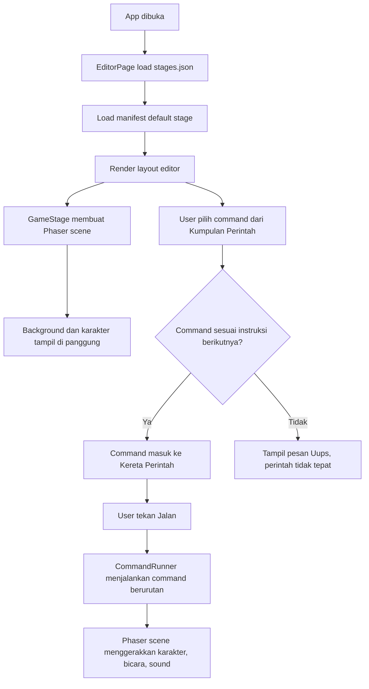
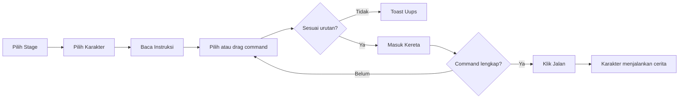
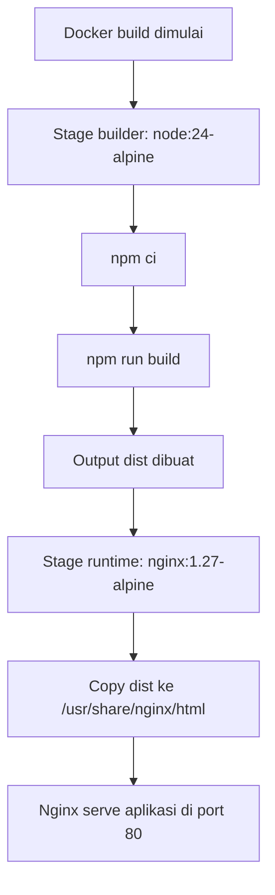

# IKOOS Junior Coding

IKOOS Junior Coding adalah aplikasi belajar coding visual untuk anak. Konsep utamanya mirip ScratchJr: anak memilih ikon perintah, menyusunnya ke kereta perintah, lalu menjalankan karakter di panggung cerita.

Project ini memakai pendekatan manifest asset. Artinya background, karakter, instruksi, sound, command, dan stage dapat diganti lewat file JSON dan folder `public/assets/stages` tanpa perlu mengubah kode React untuk setiap materi baru.

## Teknologi

- React
- TypeScript
- Vite
- Phaser
- LocalStorage untuk simpan dan buka project lokal
- Asset manifest JSON di folder `public`

## Kebutuhan Sistem

- Node.js versi modern
- npm
- Browser modern seperti Chrome, Edge, atau Firefox

Versi dependency mengikuti `package.json`.

## Instalasi

Masuk ke folder frontend:

```bash
cd frontend
```

Install dependency:

```bash
npm install
```

Jalankan development server:

```bash
npm run dev
```

Buka aplikasi:

```txt
http://localhost:5173
```

Jika port `5173` sedang dipakai, Vite otomatis memakai port berikutnya, misalnya:

```txt
http://localhost:5174
```

## Script Project

```bash
npm run dev
```

Menjalankan Vite development server.

```bash
npm run build
```

Menjalankan TypeScript build dan membuat output produksi ke folder `dist`.

```bash
npm run preview
```

Menjalankan preview dari hasil build produksi.

## Struktur Folder Utama

```txt
frontend/
  public/
    assets/
      stages/
        stages.json
        stage-1/
          manifest.json
          backgrounds/
          characters/
          sounds/
          thumbnails/
        stage-2/
          manifest.json
  src/
    components/
      AssetPanel.tsx
      GameStage.tsx
      JuniorCommandBlock.tsx
      JuniorCommandPalette.tsx
      JuniorScriptArea.tsx
      Toolbar.tsx
      UiIcon.tsx
    engine/
      commandRunner.ts
      commandTypes.ts
      phaserScene.ts
    pages/
      EditorPage.tsx
    types/
      stageAsset.ts
    utils/
      loadStageAssets.ts
      storage.ts
    index.css
    main.tsx
```

## Alur Aplikasi



## Fitur Utama

### 1. Panggung Cerita

Komponen: `src/components/GameStage.tsx`

Panggung cerita adalah area canvas Phaser yang menampilkan background dan karakter aktif. Scene Phaser dibuat di:

```txt
src/engine/phaserScene.ts
```

Fungsi penting:

- `createGame()` membuat instance Phaser.
- `JuniorScene.preload()` memuat background, karakter, object, dan sound dari manifest.
- `setBackground()` mengganti background aktif.
- `setCharacter()` mengganti karakter aktif.
- `moveBy()` menggerakkan karakter.
- `jump()` menjalankan animasi lompat.
- `say()` menampilkan bubble bicara.
- `playSound()` memainkan sound.
- `resetActor()` mengembalikan karakter ke posisi awal.

### 2. Kumpulan Perintah

Komponen:

```txt
src/components/JuniorCommandPalette.tsx
```

Kumpulan perintah membaca daftar command dari `manifest.commands`. Command dapat dipilih dengan dua cara:

- Klik ikon command.
- Drag ikon command ke slot kereta perintah.

Saat command dipilih, `EditorPage` memvalidasi apakah command sesuai instruksi stage berikutnya.

### 3. Validasi Instruksi Stage

Lokasi:

```txt
src/pages/EditorPage.tsx
```

Validasi dilakukan saat user klik atau drag command. Aplikasi membandingkan command yang dipilih dengan instruksi berikutnya dari `manifest.instructions`.

Jika benar:

- Command masuk ke kereta perintah.
- User mendapat feedback berhasil.

Jika salah:

- Command tidak masuk.
- Muncul pesan:

```txt
Uups, perintah tidak tepat.
```

Validasi yang dicek:

- `type`
- `value` jika ada
- `soundId` jika ada
- `text` jika ada

### 4. Kereta Perintah

Komponen:

```txt
src/components/JuniorScriptArea.tsx
```

Kereta perintah menampilkan urutan command yang akan dijalankan. Slot diisi berurutan dari kiri ke kanan.

Fungsi:

- Menampilkan command yang sudah dipilih.
- Menerima drag-and-drop dari palette.
- Menghapus command per slot.
- Menghapus semua command.
- Memberi highlight saat command sedang berjalan.

### 5. Runner Command

Lokasi:

```txt
src/engine/commandRunner.ts
```

`CommandRunner` menjalankan command satu per satu. Setiap command memanggil fungsi di `JuniorScene`.

Jenis command yang didukung:

- `start`
- `moveRight`
- `moveLeft`
- `moveUp`
- `moveDown`
- `turnRight`
- `turnLeft`
- `jump`
- `say`
- `sound`
- `wait`
- `reset`

### 6. Bubble Bicara

Bubble bicara dibuat langsung di Phaser scene pada fungsi:

```txt
JuniorScene.say()
```

Bubble memakai:

- teks besar dan tebal,
- background putih,
- border kuning,
- shadow,
- tail yang mengarah ke karakter,
- posisi di atas kepala karakter agar tidak menutup wajah.

### 7. Pilih Stage dan Karakter

Komponen:

```txt
src/components/AssetPanel.tsx
```

Panel ini menampilkan:

- pilihan scene/background stage,
- pilihan karakter,
- status locked untuk item yang belum aktif.

Perubahan pilihan langsung dikirim ke scene Phaser.

### 8. Save dan Load Project

Lokasi helper:

```txt
src/utils/storage.ts
```

Project disimpan ke LocalStorage browser. Data yang disimpan:

- `stageId`
- `title`
- `commands`
- `backgroundId`
- `characterId`

Tombol yang tersedia:

- `Simpan`
- `Buka`

Data bersifat lokal di browser user.

## Struktur Data Stage

Daftar stage utama ada di:

```txt
public/assets/stages/stages.json
```

Contoh:

```json
{
  "defaultStageId": "stage-1",
  "stages": [
    {
      "id": "stage-1",
      "title": "Masjid Ceria",
      "manifest": "/assets/stages/stage-1/manifest.json",
      "thumbnail": "/assets/stages/stage-1/thumbnails/stage-preview.png",
      "status": "active",
      "difficulty": 1
    }
  ]
}
```

Manifest detail stage ada di:

```txt
public/assets/stages/stage-1/manifest.json
```

Bagian penting manifest:

```json
{
  "id": "stage-1",
  "stageSize": { "width": 1500, "height": 1000, "aspectRatio": "3:2" },
  "title": "Masjid Ceria",
  "maxCommands": 5,
  "backgrounds": [],
  "characters": [],
  "sounds": [],
  "levels": [],
  "instructions": [],
  "commands": []
}
```

### Background

```json
{
  "id": "masjid-ceria",
  "name": "Masjid Ceria",
  "file": "/assets/stages/stage-1/backgrounds/masjid.png",
  "thumbnail": "/assets/stages/stage-1/thumbnails/masjid.png"
}
```

Opsional:

```json
"fit": "cover"
```

Pilihan `fit`:

- `cover`: background memenuhi panggung, sisi gambar boleh terpotong sedikit.
- `contain`: seluruh gambar terlihat, tetapi bisa muncul ruang kosong.

### Karakter

```json
{
  "id": "anak-muslim",
  "name": "Anak Muslim",
  "file": "/assets/stages/stage-1/characters/anak-muslim-laki2.png",
  "thumbnail": "/assets/stages/stage-1/thumbnails/anak-muslim-laki2.png",
  "startPosition": { "x": 340, "y": 720 },
  "displaySize": { "width": 360, "height": 360 }
}
```

`startPosition` memakai koordinat virtual stage. Jika `stageSize` adalah `1500 x 1000`, maka:

- `x: 0` berada di kiri panggung.
- `x: 1500` berada di kanan panggung.
- `y: 0` berada di atas panggung.
- `y: 1000` berada di bawah panggung.

### Instruksi

```json
{
  "order": 2,
  "command": "moveRight",
  "label": "Kanan 5",
  "icon": "arrow",
  "value": 5
}
```

Instruksi menentukan urutan jawaban benar. User harus menyusun command sesuai urutan ini.

### Level Instruksi Dalam Stage

Satu stage dapat memiliki beberapa level instruksi lewat properti `levels`.

```json
{
  "levels": [
    {
      "id": "level-1",
      "title": "Level 1",
      "label": "Lv 1",
      "description": "Mulai dari bendera, jalan, lompat, bicara, lalu suara.",
      "maxCommands": 5,
      "instructions": []
    },
    {
      "id": "level-2",
      "title": "Level 2",
      "label": "Lv 2",
      "maxCommands": 5,
      "instructions": []
    }
  ]
}
```

Jika `levels` tersedia, UI akan menampilkan tombol `Lv 1`, `Lv 2`, dan seterusnya di kartu instruksi. Validasi command, Play Contoh, dan penyusunan kereta mengikuti level yang sedang aktif.

Jika `levels` tidak tersedia, aplikasi tetap memakai `instructions` lama di level stage agar manifest lama tetap kompatibel.

### Commands

```json
{
  "type": "moveRight",
  "value": 5,
  "icon": "arrow",
  "label": "Kanan 5",
  "color": "#168eea"
}
```

Command adalah ikon yang muncul di palette `Kumpulan Perintah`.

## Cara Mengganti Asset Stage 1

1. Ganti file background di:

```txt
public/assets/stages/stage-1/backgrounds/
```

2. Ganti file karakter di:

```txt
public/assets/stages/stage-1/characters/
```

3. Ganti thumbnail di:

```txt
public/assets/stages/stage-1/thumbnails/
```

4. Update path di:

```txt
public/assets/stages/stage-1/manifest.json
```

5. Jalankan ulang browser atau refresh halaman.

## Cara Menambah Stage Baru

1. Buat folder baru:

```txt
public/assets/stages/stage-3/
```

2. Buat struktur folder:

```txt
stage-3/
  manifest.json
  backgrounds/
  characters/
  sounds/
  thumbnails/
```

3. Isi `manifest.json`.

4. Daftarkan stage di:

```txt
public/assets/stages/stages.json
```

Contoh:

```json
{
  "id": "stage-3",
  "title": "Kelas Ceria",
  "manifest": "/assets/stages/stage-3/manifest.json",
  "thumbnail": "/assets/stages/stage-3/thumbnails/stage-preview.png",
  "status": "active",
  "difficulty": 3
}
```

5. Jika belum ingin stage bisa dipilih, gunakan:

```json
"status": "locked"
```

## Rekomendasi Ukuran Asset

- Background: rasio sama dengan `stageSize`, saat ini cocok memakai `1500 x 1000`, `3000 x 2000`, atau rasio `3:2`.
- Character: PNG transparan `512 x 512` atau lebih besar.
- Thumbnail background: minimal `320 x 180`, lebih baik `600 x 338`.
- Thumbnail karakter: `320 x 320`.
- Sound: WAV atau MP3, durasi pendek 1 sampai 5 detik.

## Alur Interaksi User



## Deployment

Buat build produksi:

```bash
npm run build
```

Hasil build ada di:

```txt
dist/
```

Upload isi folder `dist` ke web server statis. Pastikan folder `assets/stages` ikut ter-copy ke output build. Vite otomatis menyalin file dari `public` ke output.

## Deployment Dengan Docker

Project ini sudah dilengkapi file Docker:

```txt
Dockerfile
docker-compose.yml
nginx.conf
.dockerignore
```

Cara kerja Docker image:



### Build Image Manual

Jalankan dari folder `frontend`:

```bash
docker build -t ikoos-junior-frontend .
```

Jalankan container:

```bash
docker run -d \
  --name ikoos-junior-frontend \
  --restart unless-stopped \
  -p 8080:80 \
  ikoos-junior-frontend
```

Buka aplikasi:

```txt
http://localhost:8080
```

Jika dijalankan di server:

```txt
http://IP_SERVER:8080
```

### Menjalankan Dengan Docker Compose

Jalankan dari folder `frontend`:

```bash
docker compose up -d --build
```

Cek container:

```bash
docker compose ps
```

Cek log:

```bash
docker compose logs -f
```

Stop container:

```bash
docker compose down
```

Default port di `docker-compose.yml` adalah:

```txt
8080:80
```

Artinya port `8080` di host akan diarahkan ke port `80` di container Nginx.

Jika ingin aplikasi langsung berjalan di port 80 server, ubah menjadi:

```yaml
ports:
  - "80:80"
```

Pastikan port 80 belum dipakai service lain.

## Deployment Di Ubuntu Server

Panduan ini diasumsikan menggunakan Ubuntu Server dan user memiliki akses `sudo`.

### 1. Update Server

```bash
sudo apt update
sudo apt upgrade -y
```

### 2. Install Docker

Install dependency dasar:

```bash
sudo apt install -y ca-certificates curl gnupg
```

Tambahkan repository Docker resmi:

```bash
sudo install -m 0755 -d /etc/apt/keyrings
curl -fsSL https://download.docker.com/linux/ubuntu/gpg | sudo gpg --dearmor -o /etc/apt/keyrings/docker.gpg
sudo chmod a+r /etc/apt/keyrings/docker.gpg
```

Tambahkan source list Docker:

```bash
echo \
  "deb [arch=$(dpkg --print-architecture) signed-by=/etc/apt/keyrings/docker.gpg] https://download.docker.com/linux/ubuntu \
  $(. /etc/os-release && echo "$VERSION_CODENAME") stable" | \
  sudo tee /etc/apt/sources.list.d/docker.list > /dev/null
```

Install Docker Engine dan Compose plugin:

```bash
sudo apt update
sudo apt install -y docker-ce docker-ce-cli containerd.io docker-buildx-plugin docker-compose-plugin
```

Cek instalasi:

```bash
docker --version
docker compose version
```

Opsional, agar user saat ini bisa menjalankan Docker tanpa `sudo`:

```bash
sudo usermod -aG docker $USER
```

Logout lalu login kembali agar group aktif.

### 3. Upload Project Ke Server

Contoh struktur target:

```txt
/var/www/ikoos-junior/frontend
```

Buat folder:

```bash
sudo mkdir -p /var/www/ikoos-junior
sudo chown -R $USER:$USER /var/www/ikoos-junior
```

Clone repository atau upload project ke folder tersebut. Contoh jika memakai Git:

```bash
cd /var/www/ikoos-junior
git clone <URL_REPOSITORY> .
cd frontend
```

Jika repository sudah berisi folder `frontend`, pastikan Anda masuk ke folder `frontend` sebelum menjalankan Docker.

### 4. Jalankan Aplikasi Dengan Docker Compose

```bash
docker compose up -d --build
```

Cek status:

```bash
docker compose ps
```

Cek log:

```bash
docker compose logs -f
```

Buka dari browser:

```txt
http://IP_SERVER:8080
```

### 5. Buka Firewall Ubuntu

Jika server memakai UFW dan aplikasi berjalan di port `8080`:

```bash
sudo ufw allow 8080/tcp
sudo ufw status
```

Jika memakai port 80:

```bash
sudo ufw allow 80/tcp
```

Jika memakai HTTPS:

```bash
sudo ufw allow 443/tcp
```

### 6. Update Aplikasi Di Server

Masuk ke folder project:

```bash
cd /var/www/ikoos-junior/frontend
```

Ambil perubahan terbaru:

```bash
git pull
```

Rebuild dan restart container:

```bash
docker compose up -d --build
```

Bersihkan image lama jika perlu:

```bash
docker image prune -f
```

### 7. Mengubah Asset Stage Di Server

Karena asset masuk ke image Docker saat build, perubahan file di:

```txt
public/assets/stages/
```

perlu diikuti rebuild container:

```bash
docker compose up -d --build
```

Jika ingin asset dapat diganti tanpa rebuild image, gunakan volume mount. Contoh:

```yaml
services:
  ikoos-junior-frontend:
    build:
      context: .
      dockerfile: Dockerfile
    ports:
      - "8080:80"
    volumes:
      - ./public/assets/stages:/usr/share/nginx/html/assets/stages:ro
```

Dengan cara ini, perubahan asset di folder host `public/assets/stages` langsung dibaca Nginx. Tetap refresh browser setelah mengganti manifest atau asset.

### 8. Opsi Domain Dan Reverse Proxy

Jika server memakai domain, pola umum adalah:

```txt
Internet -> Nginx host Ubuntu -> Docker container port 8080
```

Contoh konfigurasi Nginx host:

```nginx
server {
  listen 80;
  server_name example.com;

  location / {
    proxy_pass http://127.0.0.1:8080;
    proxy_set_header Host $host;
    proxy_set_header X-Real-IP $remote_addr;
    proxy_set_header X-Forwarded-For $proxy_add_x_forwarded_for;
    proxy_set_header X-Forwarded-Proto $scheme;
  }
}
```

Setelah membuat konfigurasi:

```bash
sudo nginx -t
sudo systemctl reload nginx
```

Untuk HTTPS, pasang SSL dengan Certbot sesuai domain server.

### 9. Troubleshooting Docker

Cek container berjalan:

```bash
docker ps
```

Cek log container:

```bash
docker logs ikoos-junior-frontend
```

Atau jika memakai Compose:

```bash
docker compose logs -f
```

Masuk ke container:

```bash
docker exec -it ikoos-junior-frontend sh
```

Cek file hasil build di container:

```bash
ls -la /usr/share/nginx/html
```

Jika halaman blank, pastikan build berhasil:

```bash
docker compose build --no-cache
```

Jika asset tidak terbaca, cek file ini ada di container:

```bash
docker exec -it ikoos-junior-frontend ls -la /usr/share/nginx/html/assets/stages
```

Jika port bentrok, ubah mapping port di `docker-compose.yml`, misalnya:

```yaml
ports:
  - "8090:80"
```

## Troubleshooting

### Asset belum terbaca

Pastikan file berikut ada:

```txt
public/assets/stages/stages.json
public/assets/stages/stage-1/manifest.json
```

Pastikan path di manifest diawali dengan:

```txt
/assets/stages/...
```

### Background terlihat terpotong

Cek nilai `fit` pada background.

Gunakan:

```json
"fit": "contain"
```

jika ingin seluruh gambar terlihat.

Gunakan:

```json
"fit": "cover"
```

jika ingin panggung selalu penuh.

### Karakter terlalu besar atau terlalu kecil

Atur nilai berikut di manifest:

```json
"displaySize": { "width": 360, "height": 360 }
```

### Posisi karakter tidak pas

Atur:

```json
"startPosition": { "x": 340, "y": 720 }
```

### Command tidak bisa masuk kereta

Command harus sesuai dengan instruksi berikutnya. Jika tidak sesuai, aplikasi akan menampilkan pesan:

```txt
Uups, perintah tidak tepat.
```

### Build menampilkan warning chunk besar

Phaser cukup besar sehingga Vite bisa memberi warning ukuran chunk. Ini bukan error. Build tetap berhasil selama output berakhir dengan:

```txt
built
```

Jika project semakin besar, pertimbangkan code splitting atau dynamic import untuk Phaser.

## Catatan Teknis

- Source utama aplikasi ada di `src/pages/EditorPage.tsx`.
- UI styling utama ada di `src/index.css`.
- Logic game ada di `src/engine`.
- File legacy Blockly belum menjadi bagian utama UI saat ini dan tidak dipakai oleh flow junior editor.
- Semua asset stage sebaiknya dikelola dari folder `public/assets/stages`.
